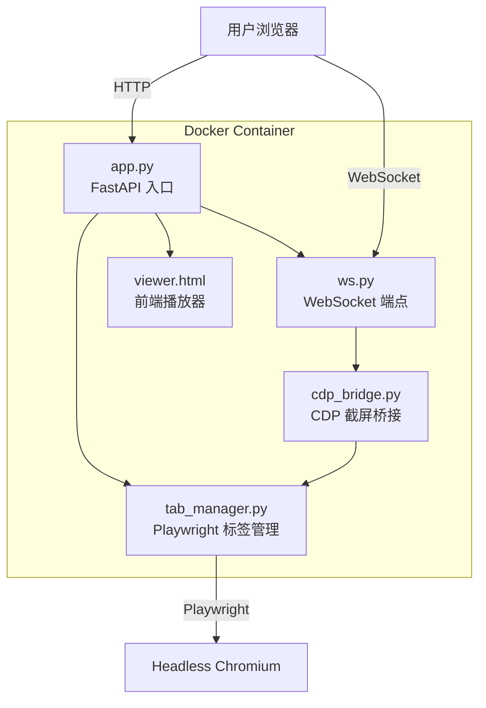

# TabShare V0 — CDP 图片传输标签页共享

> **分支**: `main` | **提交**: `0254878` | **日期**: 2026-04-02

## 概述

初始版本，基于 Chrome DevTools Protocol (CDP) 的 `Page.screencastFrame` 实现标签页实时共享。  
服务端截取每一帧为 JPEG 图片，通过 WebSocket 推送到前端 `` 标签，实现"视频流"效果。

## 架构

```mermaid
sequenceDiagram
    participant Viewer as 🖥️ Viewer (浏览器)
    participant Server as 🐍 FastAPI Server
    participant CDP as 📡 CDP Session
    participant Chrome as 🌐 Headless Chrome

    Viewer->>Server: WebSocket /ws/tab/{id}
    Server->>CDP: Page.startScreencast(jpeg, q=80)
    loop 每帧
        Chrome->>CDP: Page.screencastFrame (base64 JPEG)
        CDP->>Server: 回调 _on_screencast_frame
        Server->>Viewer: WS send(base64 image)
        Viewer->>Viewer: img.src = data:image/jpeg;base64,...
    end
```

### 组件关系



## 核心实现

### CDPBridge (`cdp_bridge.py`)

通过 Playwright 获取 CDP Session，调用 `Page.startScreencast` 持续截屏：

```python
class CDPBridge:
    async def initialize(self):
        self.cdp = await self.page.context.new_cdp_session(self.page)
        self.cdp.on("Page.screencastFrame", self._on_screencast_frame)

    async def resume_stream(self):
        await self.cdp.send("Page.startScreencast", {
            "format": "jpeg", "quality": 80, "everyNthFrame": 1
        })
```

### 前端 Viewer

收到 base64 图片后直接更新 `` 标签 `src`，模拟视频流。

## 局限性

| 问题 | 说明 |
|------|------|
| **CPU 开销高** | 每帧都需要 Python 侧 JSON 序列化 + base64 编解码 |
| **帧率低** | 受限于 CDP screencast 速率和 WS 带宽 |
| **延迟大** | 截图 → 编码 → 传输 → 解码 全链路延迟 |
| **无音频** | CDP screencast 不支持音频捕获 |
| **单向** | 仅支持观看，无输入控制 |

## 文件结构

```
tabshare/
├── main.py                     # 入口脚本
├── server/
│   ├── app.py                  # FastAPI 应用
│   ├── config.py               # 配置
│   ├── api/
│   │   └── ws.py               # WebSocket 端点
│   ├── services/
│   │   ├── tab_manager.py      # Playwright 标签管理
│   │   └── cdp_bridge.py       # CDP 截屏桥接 ⭐
│   └── static/
│       └── viewer.html         # 前端 img 播放器
└── test_*.py / test_*.js       # 测试脚本
```
