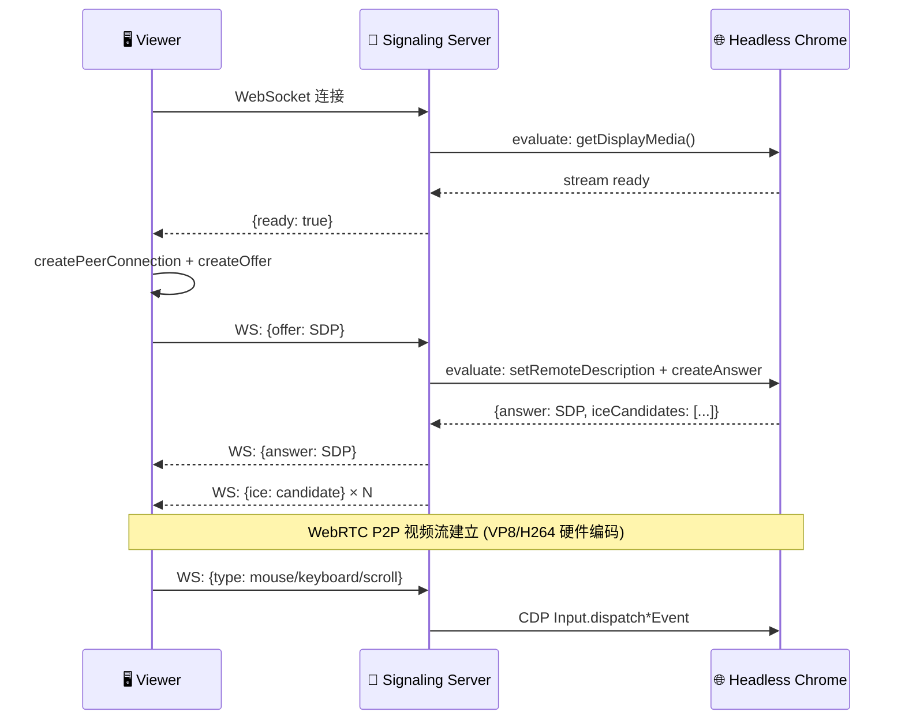
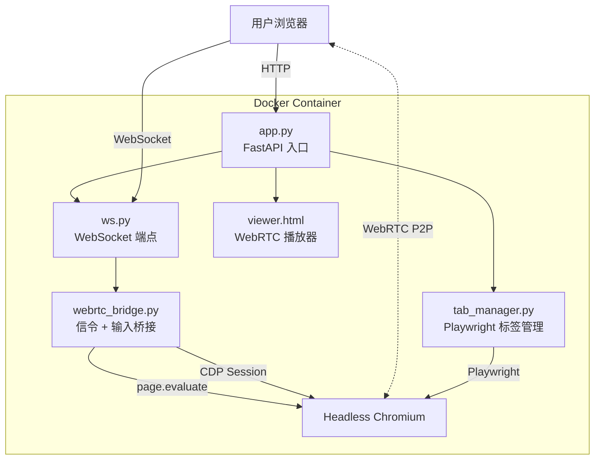
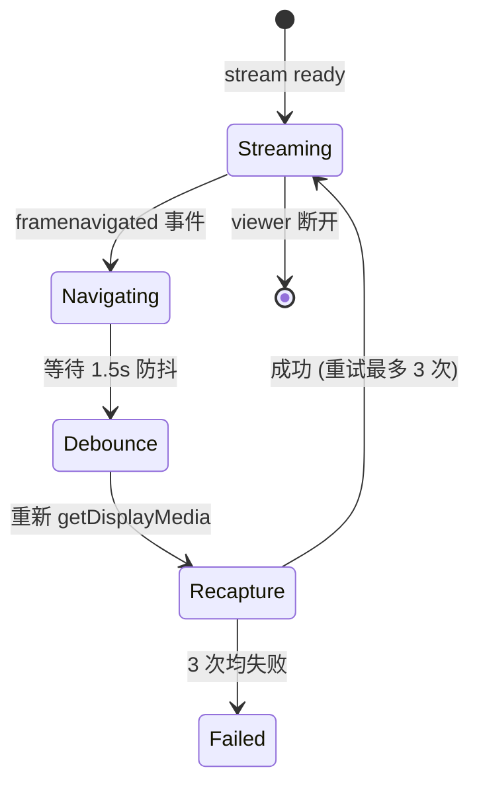

# TabShare V1 — WebRTC 原生标签页共享

> **分支**: `webrtc` | **提交**: `a43e1ac` → `d1d01b1` | **日期**: 2026-04-03

## 概述

将底层从 CDP 截屏重构为 Chrome 原生 WebRTC。通过 `getDisplayMedia({preferCurrentTab: true})` 在 Headless Chrome 内部完成视频捕获与硬件编码，Python 层完全退化为纯信令转发服务器——**零图片拷贝、零编解码开销**。

## 架构



### 组件关系



### 导航流转



## 核心实现

### WebRTCBridge (`webrtc_bridge.py`)

Python 仅做信令胶水，所有 WebRTC 逻辑通过 `page.evaluate()` 注入 Chrome 执行：

```python
class WebRTCBridge:
    async def _ensure_stream(self):
        # 在 Chrome 内部调用 getDisplayMedia
        await self.page.evaluate("""() => {
            const stream = await navigator.mediaDevices.getDisplayMedia({
                video: { displaySurface: "browser" },
                preferCurrentTab: true
            });
            window._webrtc.stream = stream;
        }""")

    async def _handle_offer(self, offer_sdp):
        # Chrome 内部创建 PeerConnection 并回传 answer
        result = await self.page.evaluate("""async ([offerSdp, sid]) => {
            const pc = new RTCPeerConnection({...});
            window._webrtc.stream.getTracks().forEach(t => pc.addTrack(t, ...));
            await pc.setRemoteDescription(offerSdp);
            const answer = await pc.createAnswer();
            await pc.setLocalDescription(answer);
            return { answer: ..., iceCandidates: ... };
        }""", [offer_sdp, sid])
```

### 输入控制 (CDP)

通过 CDP Session 分发用户输入事件到 Chrome 页面：

```python
async def _handle_mouse(self, msg):
    await self._cdp.send("Input.dispatchMouseEvent", {
        "type": msg["eventType"], "x": msg["x"], "y": msg["y"], ...
    })
```

### 多 Viewer 支持

每个 Viewer 分配独立 `session_id`，Chrome 端维护 `window._webrtc.pcs[sid]` 字典，避免多 viewer 互相覆盖 PeerConnection。

## V0 → V1 对比

| 维度 | V0 (CDP Screencast) | V1 (WebRTC) |
|------|---------------------|-------------|
| **编码** | Python 侧 base64 | Chrome 内核 VP8/H264 硬件编码 |
| **传输** | WebSocket (图片帧) | WebRTC P2P (RTP) |
| **延迟** | 高 (截图→编码→传输→解码) | 极低 (零拷贝直传) |
| **CPU** | Python 高负载 | Python 几乎零开销 |
| **输入** | ❌ 不支持 | ✅ CDP 鼠标/键盘/滚轮 |
| **多 Viewer** | ❌ | ✅ session-based PCs |
| **导航恢复** | ❌ | ✅ 防抖重连 |

## 关键 Chrome 启动参数

| 参数 | 作用 |
|------|------|
| `--headless=new` | 新版 headless，支持 getDisplayMedia |
| `--use-fake-ui-for-media-stream` | 跳过媒体权限弹窗 |
| `--auto-select-desktop-capture-source=Entire screen` | 自动选择捕获源 |
| `--disable-features=WebRtcHideLocalIpsWithMdns` | ICE 使用真实 IP |

## 部署

```bash
cd tabshare
docker build -t tabshare:v1 .
docker run -v $PWD:/app --network=host --init --rm --ipc=host tabshare:v1
```

访问 http://localhost:8085

## 文件结构

```
tabshare/
├── Dockerfile                  # Playwright 镜像
├── pyproject.toml
├── server/
│   ├── app.py                  # FastAPI 应用 + 生命周期
│   ├── config.py               # HOST / PORT / CHROME_PATH
│   ├── api/
│   │   └── ws.py               # WebSocket 端点
│   ├── services/
│   │   ├── tab_manager.py      # Playwright 浏览器管理
│   │   └── webrtc_bridge.py    # WebRTC 信令 + CDP 输入 ⭐
│   └── static/
│       └── viewer.html         # WebRTC 前端 + 输入捕获
```
