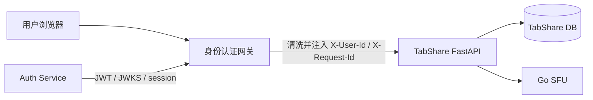
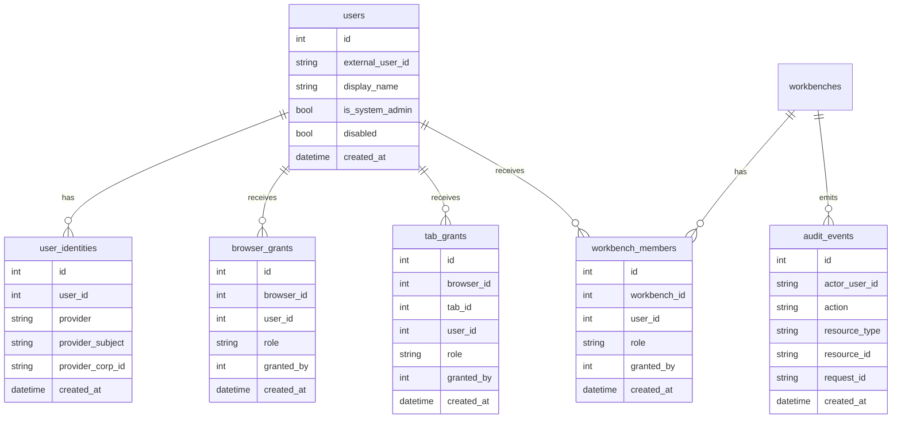
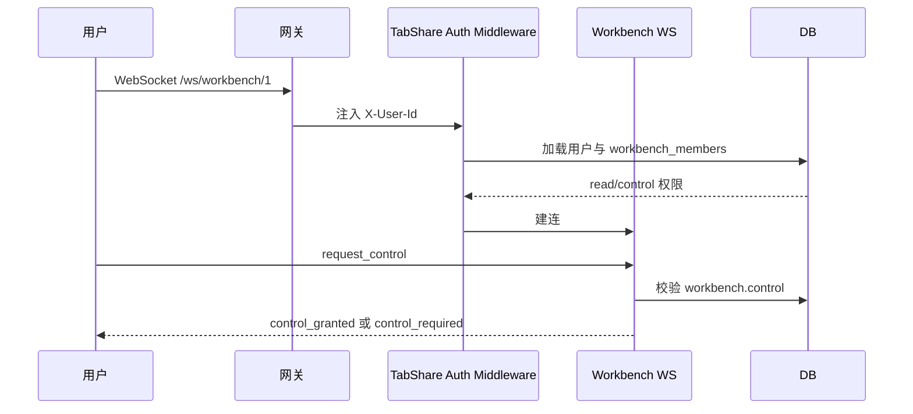
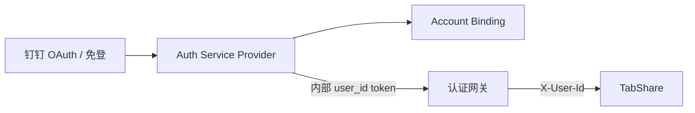

# TabShare V2 — Workbench 权限管理与身份认证网关

## 结论

V2 不做多租户，只做“系统管理员 + 用户资源授权”。身份认证网关只负责证明“是谁”，TabShare 负责判断“能不能访问或管理某个 Browser / Tab / Workbench”。

普通用户登录后只看到已授权的 Workbench；如果没有任何授权，页面提示其通过其他渠道向管理员申请 Workbench。系统管理员拥有全部权限，并可把 Browser、Tab、Workbench 分配给指定用户。Workbench 创建者可以把自己的 Workbench 分配给其他用户。录制开关属于 Workbench 修改权限。

## 边界

| 范围 | V2 做 | V2 不做 |
| --- | --- | --- |
| 身份认证 | 接入认证网关可信身份头 | 不在 TabShare 内实现登录页 |
| 多租户 | 不做 | 不引入 tenant/org/project |
| 系统管理员 | 拥有全部资源和全部动作 | 不通过网关 role/scope 判断业务权限 |
| 普通用户 | 只访问已授权 Workbench | 不访问全局 Browser/Tab 管理后台 |
| 钉钉登录 | 预留到 Auth Service Provider | 不直接把钉钉用户当 TabShare 用户 |
| 授权 | TabShare 数据库维护资源授权 | 网关不维护 Workbench 权限 |

## 架构



认证网关必须清理所有外部传入的身份头，再注入可信身份头。TabShare 只能信任来自网关或内网的请求。

## 网关基线

V2 认证网关以 `demo/v0.12` 为 POC 基线。该版本已经验证 JWT/JWKS 离线验签、`kid` 轮换、session introspection、统一登录页、全局退出、身份头清洗和连接层参数，适合作为 TabShare 专用网关的起点。

不能直接原样使用 `demo/v0.12`。它当前是通用 demo，默认 upstream 是 `app-service`，并且主要保护 `/api/`，还需要改成 TabShare 路由模型。

### 复用内容

| 能力 | 处理 |
| --- | --- |
| OpenResty 网关 | 复用 |
| EdDSA JWT + JWKS | 复用 |
| `iss` / `aud` / `exp` / `sub` 校验 | 复用 |
| `X-User-Id` / `X-Request-Id` 注入 | 复用 |
| 外部身份头清洗 | 复用 |
| session introspection | 高风险动作预留 |
| 登录页、SSO、logout demo | 作为 Auth Service 原型 |
| upstream keepalive、worker、nofile 参数 | 复用并按 TabShare 压测调整 |

### TabShare 专用改造

| 项 | 改造要求 |
| --- | --- |
| upstream | `app_service` 改为 `tabshare:8085` |
| `AUTH_AUDIENCE` | 改为 `tabshare-api` |
| 页面路由 | `/admin`、`/workbench/*`、`/viewer/*` 需要认证后访问 |
| API 路由 | `/api/*` 需要认证，未认证返回 JSON `401` |
| WebSocket | `/ws/*` 需要认证并支持 `Upgrade` |
| 静态资源 | `/static/*` 可公开，业务数据仍由 API 认证 |
| 登录跳转 | 页面请求未登录时跳登录域；pilot 使用 `https://auth-pilot.lprintf.com/login/page?redirect_uri=...` |
| Header 清洗 | 所有转发路径都清空外部 `X-User-Id` 等身份头 |
| SFU | 不暴露 SFU HTTP 管理口，只允许 TabShare 内部访问 |
| debug | 网关认证后仍由 TabShare 用 `system_admin` 二次授权 |

pilot 环境的业务入口使用 `https://bs-pilot.lprintf.com/admin`，认证入口使用 `https://auth-pilot.lprintf.com/login/page`。两个域都映射到 auth-gateway 的 `18080`，由网关按 Host 分流；Auth Service 在 `.lprintf.com` 写入 `Secure` session cookie，登录后回到业务域。

### 最小网关 POC 验收

| 场景 | 预期 |
| --- | --- |
| 未登录访问 `/admin` | 跳转登录页 |
| 登录后访问 `/admin` | 正常打开 |
| `GET /api/admin/workbenches` | TabShare 收到可信 `X-User-Id` |
| `/ws/workbench/{id}` | WebSocket 能通过网关连接 |
| 外部伪造 `X-User-Id` | 被网关清洗，不能透传 |
| `/static/*` | 不需要登录即可加载静态文件 |

网关 POC 的目标只验证认证边界，不实现 Workbench 授权。Workbench ACL 在 TabShare 内完成。

## 角色模型

| 角色 | 粒度 | 权限 |
| --- | --- | --- |
| `system_admin` | 全局 | 所有 Browser、Tab、Workbench、录制、成员、debug 接口 |
| `workbench_owner` | 单个 Workbench | 查看、控制、修改、录制、成员分配、删除 |
| `workbench_editor` | 单个 Workbench | 查看、控制、修改 tabs、开关录制 |
| `workbench_controller` | 单个 Workbench | 查看、控制、切换 tab、导航、上传 |
| `workbench_viewer` | 单个 Workbench | 只查看 |

`workbench_owner` 默认为 Workbench 创建者。系统管理员创建 Workbench 时可以指定 owner；未指定时 owner 为系统管理员自己。

## 权限动作

| 动作 | 说明 | 允许角色 |
| --- | --- | --- |
| `workbench.read` | 查看 Workbench 和连接 viewer | owner/editor/controller/viewer/system_admin |
| `workbench.control` | 鼠标、键盘、导航、切换 tab、上传 | owner/editor/controller/system_admin |
| `workbench.modify` | 改名、增删 tabs、修改活动 tab | owner/editor/system_admin |
| `workbench.record` | 开始/停止录制，查看录制状态 | owner/editor/system_admin |
| `workbench.manage_members` | 分配 Workbench 给其他用户 | owner/system_admin |
| `workbench.delete` | 删除 Workbench | owner/system_admin |
| `browser.manage` | 创建、启动、关闭、删除 Browser | system_admin |
| `tab.manage` | 创建、关闭、分配 Tab | system_admin |
| `debug.admin` | eval、GPU info、encoder stats | system_admin |

录制开关归入 `workbench.record`，它是 Workbench 修改权限的一部分，但单独列出便于审计和 UI 控制。

## 数据模型



### 表说明

| 表 | 用途 |
| --- | --- |
| `users` | TabShare 本地用户缓存；`external_user_id` 对应网关注入的 `X-User-Id` |
| `user_identities` | 后续绑定钉钉、邮箱等外部身份 |
| `browser_grants` | 系统管理员把 Browser 分配给用户 |
| `tab_grants` | 系统管理员把 Tab 分配给用户 |
| `workbench_members` | Workbench 授权核心表 |
| `audit_events` | 授权、录制、控制、删除等审计 |

V2 的主路径优先依赖 `workbench_members`。Browser/Tab grant 只用于管理员把资源交给用户创建或维护 Workbench，不作为普通用户主界面的默认资源列表。

## 请求身份上下文

TabShare 增加认证中间件：

| 来源头 | 说明 |
| --- | --- |
| `X-User-Id` | 认证网关注入的内部用户 ID |
| `X-Request-Id` | 网关注入或生成的请求 ID |
| `X-Auth-Session-Verified` | 高风险动作可选使用，V2 先预留 |

中间件输出：

```text
AuthContext(
  user_id=<users.id>,
  external_user_id=<X-User-Id>,
  is_system_admin=<users.is_system_admin>,
  request_id=<X-Request-Id>
)
```

如果没有可信身份头，HTTP API 返回 `401`，WebSocket 关闭连接。开发环境可以配置显式的 `DEV_AUTH_USER_ID`，但生产环境必须关闭。

## API 授权矩阵

| 接口 | 权限 |
| --- | --- |
| `GET /api/admin/workbenches` | 返回当前用户可读的 Workbench；system_admin 返回全部 |
| `POST /api/admin/workbenches` | system_admin；或拥有相关 Browser/Tab grant 的用户 |
| `GET /api/admin/workbenches/{id}` | `workbench.read` |
| `POST /api/admin/workbenches/{id}/tabs` | `workbench.modify` |
| `POST /api/admin/workbenches/{id}/tabs/remove` | `workbench.modify` |
| `POST /api/admin/workbenches/{id}/recording` | `workbench.record` |
| `DELETE /api/admin/workbenches/{id}` | `workbench.delete` |
| `GET/POST /api/admin/workbenches/{id}/members` | `workbench.manage_members` |
| `/api/admin/browsers*` | `system_admin` |
| `/api/admin/browsers/{id}/tabs*` | `system_admin`，后续可按 grant 放开 |
| `/api/files/{room}/{filename}` | 能找到对应 Workbench 且有 `workbench.record` 或 `workbench.read`，具体下载策略再定 |
| `/api/eval/*`、`/api/gpu-info/*`、`/api/encoder-stats` | `system_admin` |

## WebSocket 授权

| 连接 | 建连要求 | 消息要求 |
| --- | --- | --- |
| `/ws/workbench/{id}` | `workbench.read` | 输入类消息需要 `workbench.control` |
| `/ws/tab/{browser_id}/{tab_id}` | system_admin，或后续明确授权 | 输入类消息需要同等权限 |

控制权仍然是运行态互斥锁，但不再等同于权限。用户必须先有 `workbench.control`，才允许 `request_control`。



## 普通用户体验

| 状态 | 页面行为 |
| --- | --- |
| 有授权 Workbench | 只显示这些 Workbench |
| 无授权 Workbench | 显示空状态：暂无可访问工作台，请通过其他渠道向管理员申请 |
| 权限被移除 | 页面收到 403 或 WS 关闭后提示权限已变更 |
| 只有 viewer 权限 | 能打开 Workbench，但控制按钮禁用 |
| 有 control 权限 | 可申请控制权、操作页面 |
| 有 editor/owner 权限 | 可修改 tabs、开关录制 |

普通用户不显示 Browser/Tab 全局管理入口，避免误导其认为自己可以管理全局资源。

## 管理员体验

| 能力 | 说明 |
| --- | --- |
| 用户列表 | 查看已登录或已同步用户 |
| 分配 Browser/Tab | 把资源授权给用户，用于创建或维护 Workbench |
| 分配 Workbench | 给用户添加 Workbench role |
| 查看审计 | 查看授权、录制、删除、控制权变更 |
| 全局管理 | 保留现有 Browser/Tab/Workbench 管理能力 |

## 钉钉登录预留

钉钉登录只进入 Auth Service，不侵入 TabShare 权限模型。



TabShare 只接收内部 `user_id`。钉钉的 `unionId`、`openId`、`corpId`、手机号、姓名等外部字段由 Auth/Account Service 维护，TabShare 不直接依赖。

## 实施顺序

| 阶段 | 目标 | 交付 |
| --- | --- | --- |
| 1 | TabShare 网关 POC | 从 `demo/v0.12` 抽出专用网关，保护页面、API、WebSocket |
| 2 | 身份上下文 | FastAPI HTTP/WS 读取可信身份头，开发环境显式 mock |
| 3 | 用户与管理员 | `users` 表、system_admin 初始化、`/api/me` |
| 4 | Workbench ACL | `workbench_members`，创建者 owner，列表按用户过滤 |
| 5 | API 授权 | Workbench CRUD、录制、文件下载、debug 接口补权限 |
| 6 | WebSocket 授权 | 建连 read，控制消息 control，权限变化后断开 |
| 7 | 管理 UI | 管理员分配用户；普通用户只看授权 Workbench |
| 8 | Browser/Tab grant | 管理员把 Browser/Tab 分配给用户，用于创建 Workbench |
| 9 | 审计 | 授权变更、录制、删除、控制权事件 |
| 10 | 钉钉登录 | Auth Service 增加钉钉 Provider，绑定内部 user_id |

## 验收标准

| 场景 | 预期 |
| --- | --- |
| 未登录访问 `/admin` | 401 或跳转登录 |
| 普通用户无 Workbench | 只能看到申请提示 |
| 普通用户访问未授权 Workbench URL | 403 |
| viewer 用户申请控制权 | 拒绝 |
| controller 用户申请控制权 | 允许 |
| editor 用户开关录制 | 允许并记录审计 |
| owner 分配 Workbench 给用户 | 允许并记录审计 |
| 普通用户访问 Browser 管理 API | 403 |
| 外部伪造 `X-User-Id` | 网关清洗，TabShare 不信任直连 |

## 需要先确认的产品细节

| 问题 | 推荐默认 |
| --- | --- |
| Workbench 创建者是否一定能删除 | 是，owner 可删除 |
| editor 是否能管理成员 | 否，只有 owner/system_admin |
| record 下载是否 viewer 可见 | 默认否；先要求 `workbench.record` |
| Browser/Tab grant 是否允许普通用户创建 Workbench | 可以，但作为第 7 阶段再放开 |
| 用户禁用后已有 WS 怎么处理 | 关闭连接，并在后续请求返回 403 |
