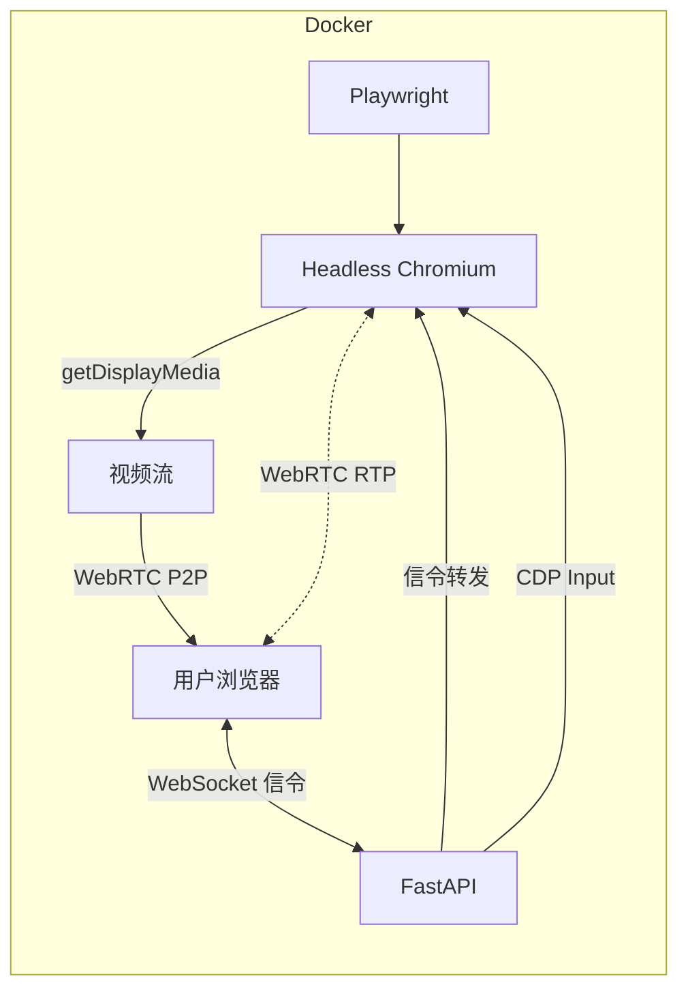

# TabShare 文档

基于 Playwright + WebRTC 的容器化浏览器标签页实时共享系统。

## 架构概览

## 文档索引

### 技术方案

| 文档 | 说明 |
|------|------|
| [v0 — CDP 图片传输](./design/v0-图片传输标签页共享.md) | 初版方案：CDP screencast + base64 图片推送 |
| [v1 — WebRTC 原生共享](./design/v1-webrtc标签页共享.md) | 当前方案：Chrome 原生 WebRTC + CDP 输入 |

### 版本记录

| 文档 | 说明 |
|------|------|
| [changelog](./changelog/) | 各版本变更日志 |
